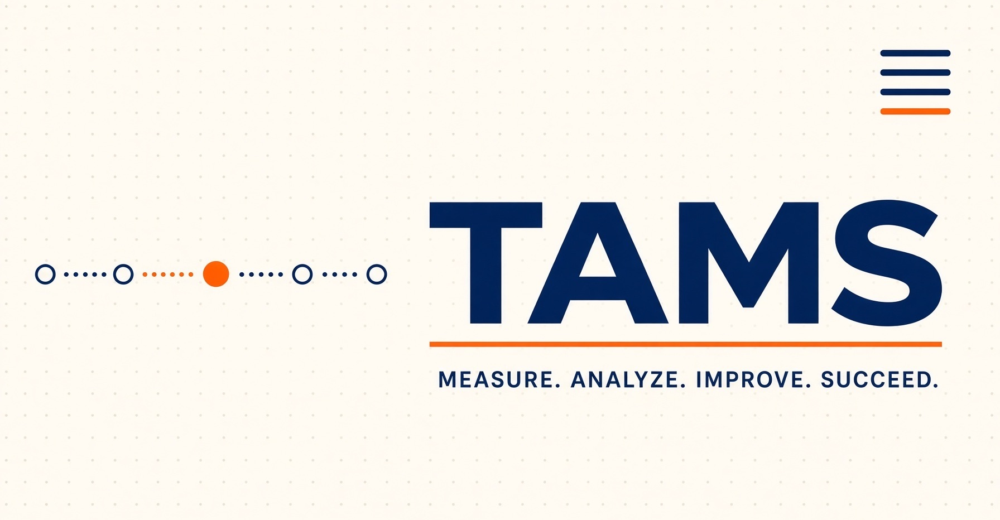

# tams



**Complete Rust client and models for the [Time-Addressable Media Store (TAMS)](https://tams.org/) API (v8.2).**

Full coverage of the official OpenAPI specification.

[](https://crates.io/crates/tams)
[](https://docs.rs/tams)
[](LICENSE)

## Features

- Complete async HTTP client for all TAMS operations
- Models for Sources, Flows, Segments, Profiles, Webhooks, Objects, Storage, Service
- Proper `Timestamp` / `TimeRange` serialization
- Bearer token authentication

## Covered operations

| Area | Methods |
|------|---------|
| Root / Service | `get_root`, `get_service`, `update_service`, `list_storage_backends` |
| Profiles | `list_profiles`, `get_profile`, `create_profile` |
| Webhooks | `list_webhooks`, `create_webhook`, `get_webhook`, `update_webhook`, `delete_webhook` |
| Sources | `list_sources`, `get_source`, label/description/tags get/set/delete |
| Flows | `list_flows`, `get_flow`, `put_flow`, `delete_flow`, label/description/tags/status/bit-rates/read-only/flow-collection |
| Segments | `list_segments`, `create_segments`, `delete_segments` |
| Storage | `allocate_storage` |
| Objects | `list_objects`, `create_object_instances`, `delete_object_instances` |
| Delete requests | `list_flow_delete_requests`, `get_flow_delete_request` |

## Quick start

```toml
[dependencies]
tams = "0.1"
tokio = { version = "1", features = ["full"] }
```

```rust
use tams::{Client, Flow, Source};
use uuid::Uuid;

#[tokio::main]
async fn main() -> tams::Result<()> {
    let client = Client::with_bearer_token("https://example.com/tams/v8.2", "token")?;

    let service = client.get_service().await?;
    let flows = client.list_flows().await?;

    Ok(())
}
```

See the [official spec](https://github.com/bbc/tams) for full details.

## License

Apache-2.0
